  
  
  
  

  
  

---

## About Me

I'm a software engineering graduate in Electronics and Communication Engineering from **Madras Institute of Technology, Anna University**. I enjoy building reliable backend applications, useful web experiences, and practical AI-powered products.

- Focused on **Python backend development**, API design, and clean application architecture.
- Building REST APIs with **FastAPI**, authentication, database integration, and testing.
- Working with **React** and modern frontend tools to create usable interfaces.
- Exploring AI/ML through NLP, computer vision, and LLM-powered applications.
- Practising data structures and algorithms and continuously improving my engineering skills.

## Current Focus

- Designing maintainable backend services with FastAPI.
- Building REST APIs, authentication flows, and CRUD applications.
- Working with PostgreSQL, SQLAlchemy, and database migrations.
- Integrating AI/LLM capabilities into practical products.
- Improving testing, Docker workflows, and deployment practices.

## Featured Project — TrustPulse AI

### TrustPulse AI
**“Verified AI & Technology News, Without the Noise.”**

TrustPulse AI is an independent AI and technology news initiative I am developing. Its goal is to help people follow AI and technology developments through a focused experience, with less information overload.

**Product direction**
- News collection and deduplication.
- AI-assisted analysis and summarisation.
- Structured presentation of technology updates.
- A modern frontend and maintainable backend foundation.

**Technology used in the project**

  
  
  
  
  
  
  
  

*TrustPulse AI is an independent project in active development. Its public updates are available on LinkedIn; the main application source is not currently public.*

## Featured Projects

| Project | Description | Technologies |
|---|---|---|
| [Smart Hostel Issue Tracker](https://github.com/Janarthanana057/smart-hostel-issue-tracker) | Web application for submitting and tracking hostel issues. | Python, FastAPI, PostgreSQL, SQLAlchemy, Docker, JWT |
| [Pothole Detection System](https://github.com/Janarthanana057/Pothole-Detection-System) | Computer-vision project for detecting potholes in road images and video. | Python, YOLO, OpenCV, Deep Learning |
| [Personal Expense Tracker](https://github.com/Janarthanana057/Personal-Expense-Tracker) · [Live Demo](https://personal-expensetracker.streamlit.app/) | Tracks income and expenses and presents spending insights. | Python, Streamlit, Pandas, Matplotlib |
| KIT VoiceMate | Hackathon prototype for a college voice assistant with public and authenticated user flows. | Python, FastAPI, Groq Whisper, LLM integration |
| Smart Q&A System | Transformer-based question-answering prototype using contextual text understanding. | Python, Hugging Face, DistilBERT, T5 |
| Sentiment Analysis API | NLP pipeline that exposes text sentiment predictions through a REST endpoint. | Python, FastAPI, TF-IDF, scikit-learn |

## Technical Skills

| Area | Technologies |
|---|---|
| Programming | Python, SQL |
| Frontend | React, HTML, CSS, TypeScript |
| Backend | FastAPI, Flask, REST APIs, Streamlit |
| Databases & ORM | PostgreSQL, SQLite, SQLAlchemy, Alembic |
| Authentication | JWT, OAuth2, bcrypt |
| AI / ML | Pandas, NumPy, scikit-learn, NLP, Deep Learning, YOLO, OpenCV, Hugging Face |
| Tools | Git, GitHub, Docker, Docker Compose, GitHub Actions, Pytest |
| Core CS | Data Structures & Algorithms, OOP, DBMS, Operating Systems, Computer Networks |

## Experience

**Software Engineer Intern — Proxenix**  
*July 2025 – September 2025*
- Worked on a sentiment analysis application using Python and TF-IDF.
- Developed FastAPI REST endpoints for model predictions.
- Contributed to preprocessing and prediction workflows.

**Software Engineer / ML Intern — Marscaptech Software Solutions**  
*May 2025 – July 2025*
- Worked on a machine-learning-based diabetes prediction project.
- Applied model evaluation and tuning.
- Built an interactive Streamlit application.

## Education & Certifications

**B.E. — Electronics and Communication Engineering**  
Madras Institute of Technology, Anna University · 2026

**Diploma — Electronics and Communication Engineering**  
Rajagopal Polytechnic College

**Certifications**
- Python for Beginners — Scaler Academy
- Basics of Python — Udemy
- Python (Basic) — HackerRank
- SQL (Basic) — HackerRank
- Problem Solving (Basic) — HackerRank
- REST API (Intermediate) — HackerRank

## Problem Solving

  
  

I regularly practise data structures and algorithms, including arrays, strings, hashing, recursion, trees, graphs, and dynamic programming.

## GitHub Activity

### Contribution Snake

  <picture>
    <source media="(prefers-color-scheme: dark)" srcset="https://raw.githubusercontent.com/Janarthanana057/Janarthanana057/output/github-contribution-grid-snake-dark.svg" />
    <source media="(prefers-color-scheme: light)" srcset="https://raw.githubusercontent.com/Janarthanana057/Janarthanana057/output/github-contribution-grid-snake.svg" />
    
  </picture>

---

## Connect With Me

<a href="mailto:janarthanan057@gmail.com">Email</a> ·
<a href="https://www.linkedin.com/in/janarthanan-s-649729262/">LinkedIn</a> ·
<a href="https://janarthanan-vert.vercel.app/">Portfolio</a> ·
<a href="https://github.com/Janarthanana057">GitHub</a> ·
<a href="https://www.linkedin.com/company/143895932/">TrustPulse AI</a>

**Open to software engineering opportunities — Python Backend · APIs · React · AI/ML**

